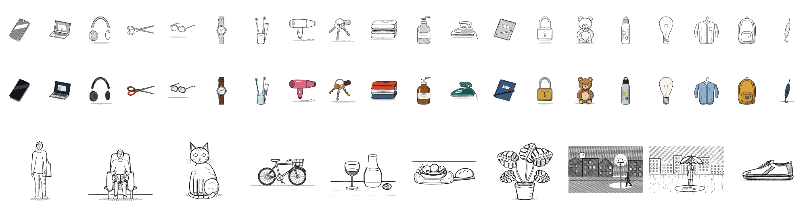

# Skills

Skills for coding agents (Claude Code, Codex, Cursor and others that read `SKILL.md`).



## doodle

Draws anything as a code-generated line illustration: objects, products, people,
plants, buildings, landscapes, scenes and storyboards. Every drawing is authored as
geometry and rendered by a seeded "hand", so the result looks drawn. It is judged as a
finished line drawing first, with colour as a second pass. The engine is plain HTML and
JS, bundled inside the skill, with nothing to install.

```sh
npx skills add vishlbhardwaj/skills --skill doodle
```

Then ask your agent to "doodle a bicycle" or "draw a rainy street in pen and ink".
On first use it copies the engine into `./doodle` in your project and draws there.

[Read the skill](skills/doodle/SKILL.md)

## clean-illustration

The same engine with the hand switched off: crisp even lines, exact geometry, flat
colour. Needs `doodle` installed too.

```sh
npx skills add vishlbhardwaj/skills --skill clean-illustration
```

[Read the skill](skills/clean-illustration/SKILL.md)

## Install everything

```sh
npx skills add vishlbhardwaj/skills
```

Or as a Claude Code plugin:

```
/plugin marketplace add vishlbhardwaj/skills
/plugin install vishlbhardwaj-skills@vishlbhardwaj
```

## Requirements

Chrome or Chromium (for rendering and checks; set `CHROME=/path` if it is somewhere
unusual) and python3. Each skill includes its own licence and any third-party notices.
